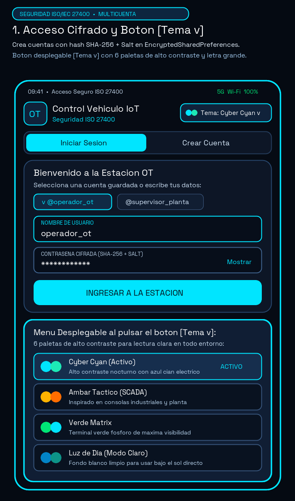
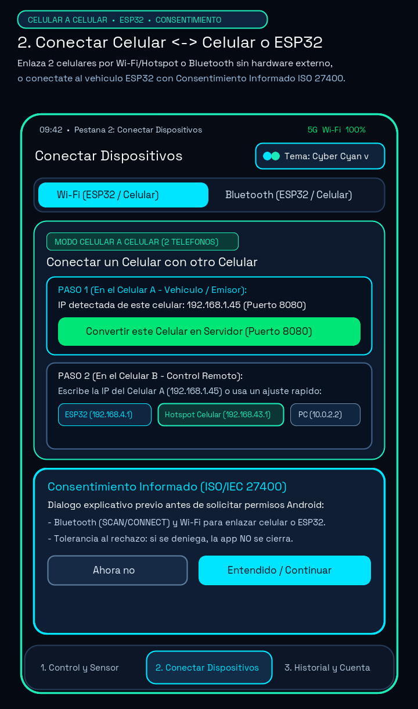
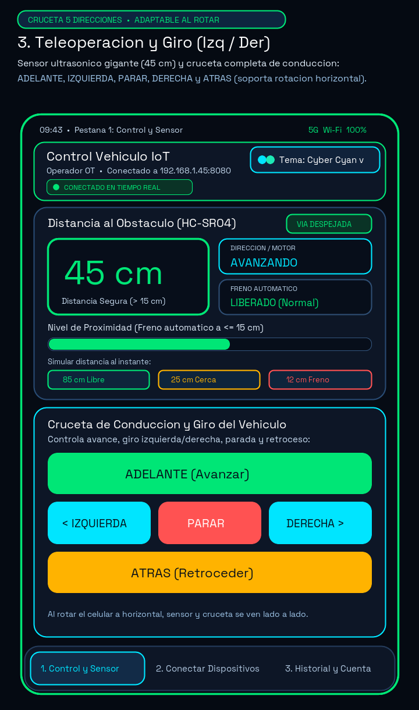
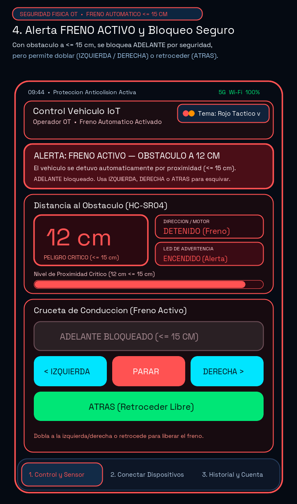

# Estación de Monitoreo y Teleoperación OT — Vehículo de Inspección IoT (ESP32 y Celular ↔ Celular)

Aplicación móvil nativa Android desarrollada en **Kotlin** con **Jetpack Compose (Material 3)** y arquitectura **MVVM limpia**, diseñada como **Estación Comercial de Monitoreo y Teleoperación** de un Vehículo Autónomo / Móvil de Inspección IoT basado en **ESP32** (sensor ultrasónico **HC-SR04**, puente H **L298N** y **LED de advertencia**) o en modo **Celular a Celular (2 Teléfonos)**, cumpliendo con los estándares de ciberseguridad **ISO/IEC 27400**, tipografía de alta legibilidad y tolerancia a fallos.

---

## 1. Pantallazos Descriptivos de la Aplicación (Presentación Comercial)

Los siguientes pantallazos descriptivos están incluidos en la carpeta [`docs/screenshots/`](docs/screenshots/) del repositorio y destacan las ventajas clave del producto:

| 1. Acceso Cifrado, Multicuenta y Botón `[Tema ▼]` | 2. Conectar Celular ↔ Celular, ESP32 y Consentimiento |
| :---: | :---: |
|  |  |
| **Seguridad ISO 27400 y Personalización:** Pestañas para **Iniciar Sesión** y **Crear Cuenta** con hashing `SHA-256 + Salt` en `EncryptedSharedPreferences`, e ícono/botón superior compacto **`[Tema ▼]`** que despliega 6 paletas de alto contraste. | **Pestaña 2 (`Conectar Dispositivos`):** Permite enlazar **un celular con otro celular** (por Wi-Fi, Hotspot o Bluetooth RFCOMM) o conectarse al vehículo **ESP32**, mostrando primero el diálogo de **Consentimiento Informado ISO 27400**. |

| 3. Pestaña `Control y Sensor` (Cruceta 5 Direcciones) | 4. Protección Anticolisión `⚠️ FRENO ACTIVO` (`<= 15 cm`) |
| :---: | :---: |
|  |  |
| **Pestaña 1 (`Control y Sensor`):** Interfaz despejada con lectura en vivo del sensor **HC-SR04** (`45 cm`) y **Cruceta / D-Pad de 5 Direcciones** (**`▲ ADELANTE`**, **`◄ IZQUIERDA`**, **`■ PARAR`**, **`DERECHA ►`**, **`▼ ATRÁS`**), adaptable a pantalla vertical y horizontal. | **Seguridad Física Automática:** Cuando `distancia <= 15 cm`, se despliega **`⚠️ FRENO ACTIVO`**, se bloquea **`ADELANTE`** para evitar choque frontal y se mantienen habilitados **`◄ IZQUIERDA`**, **`DERECHA ►`**, **`■ PARAR`** y **`▼ ATRÁS`** para esquivar o retroceder. |

---

## 2. Organización Limpia en 3 Pestañas, Rotación de Pantalla y Alta Legibilidad

Para ofrecer una experiencia comercial intuitiva, ordenada y sin saturar una sola pantalla, la aplicación está estructurada en **3 secciones independientes** accesibles desde la barra inferior (`NavigationBar`) y soporta **rotación completa del teléfono (Vertical ↔ Horizontal)** sin perder estado, conexión ni botones:

1. **Pestaña 1 — `Control y Sensor` (Cruceta de 5 Direcciones y Telemetría)**:
   - Dedicada exclusivamente a la conducción: tarjeta de distancia ultrasónica **HC-SR04** con números gigantes (`54 sp`), barra de proximidad con código de colores, alerta de emergencia (`<= 15 cm`) y **Cruceta / D-Pad de 5 Direcciones** (**`▲ ADELANTE`**, **`◄ IZQUIERDA`**, **`■ PARAR`**, **`DERECHA ►`**, **`▼ ATRÁS`**).
   - **Diseño Adaptativo al Rotar el Teléfono (Vertical y Horizontal)**: En orientación horizontal (`maxWidth >= 620.dp`), la tarjeta ubica el **Sensor HC-SR04 a la izquierda** y la **Cruceta D-Pad de 5 botones a la derecha** en 2 columnas paralelas con desplazamiento fluido, conservando todos los botones, diálogos y funciones accesibles.
2. **Pestaña 2 — `Conectar Dispositivos` (Celular ↔ Celular, ESP32 y PC)**:
   - Guía paso a paso para conectar **dos celulares entre sí** (Wi-Fi / Hotspot o Bluetooth), conectarse al **ESP32 real (`192.168.4.1`)** o probar en 1 toque con el simulador integrado, además del panel de **Consentimiento Informado ISO/IEC 27400**.
3. **Pestaña 3 — `Historial y Cuenta` (Perfil, Temas y Auditoría JSON)**:
   - Gestión de la cuenta activa, botón desplegable de paleta de colores, cambio de contraseña cifrada, cierre de sesión seguro y consola de tramas JSON recibidas de `/telemetria`.

### Botón / Ícono Desplegable de Paleta de Colores (`[Tema ▼]`)
En lugar de ocupar espacio en la pantalla con listas largas de colores, la cabecera superior incluye el botón compacto **`[Tema: <Nombre> ▼]`** con ícono de paleta y doble punto cromático. Al pulsarlo, se despliega una ventana modal (`PalettePickerDialog`) con **6 temas de alto contraste** persistidos en `EncryptedSharedPreferences`:
- **Cyber Cyan** (Oscuro — Cian eléctrico y turquesa de alto contraste).
- **Ámbar Táctico** (Oscuro — Inspirado en consolas industriales SCADA).
- **Verde Matrix** (Oscuro — Fósforo verde de máxima visibilidad).
- **Neón Violeta** (Oscuro — Alta tecnología con contraste púrpura/magenta).
- **Rojo Táctico** (Oscuro — Preservación visual nocturna y alerta).
- **Luz de Día** (Claro — Fondo blanco limpio con letras oscuras para uso bajo luz solar directa).

---

## 3. Conexión de Celular a Celular (2 Teléfonos por Wi-Fi, Hotspot o Bluetooth)

La aplicación permite conectar **un celular directamente con otro celular** sin necesidad de un ESP32 físico ni un computador externo. Un teléfono actúa como **Vehículo / Sensor Emisor (Celular A)** y el otro como **Mando de Control Remoto (Celular B)**:

### Opción A: Celular a Celular por Wi-Fi o Zona Wi-Fi (Hotspot)
1. Conecte ambos celulares a la misma red Wi-Fi, o active **Compartir Internet (Zona Wi-Fi / Hotspot)** en uno de los celulares y conecte el otro a esa red.
2. En el **Celular A (Vehículo / Emisor)**:
   - Abra la pestaña **`2. Conectar Dispositivos`** y seleccione el modo **Wi-Fi**.
   - La app detecta y muestra automáticamente la **IP de este celular** en pantalla (por ejemplo `192.168.1.45` o `192.168.43.1`).
   - Pulse el botón verde **"Convertir este Celular en Servidor (Puerto 8080)"**. El servidor HTTP se abrirá en todas las interfaces de red (`0.0.0.0:8080`).
3. En el **Celular B (Mando de Control)**:
   - En la pestaña **`2. Conectar Dispositivos`**, escriba la IP mostrada en el Celular A con el puerto `8080` (o toque el chip rápido **`Hotspot Celular (192.168.43.1:8080)`**) y pulse **"Conectar Ahora"**.
   - Al presionar **`ADELANTE`**, **`IZQUIERDA`**, **`PARAR`**, **`DERECHA`** o **`ATRÁS`** en el Celular B, el Celular A actualizará su dirección, motor y distancia en tiempo real.

### Opción B: Celular a Celular por Bluetooth Clásico (RFCOMM SPP)
1. Vincule ambos celulares desde los **Ajustes Bluetooth** de Android.
2. En el **Celular A (Vehículo / Emisor)**:
   - En la pestaña **`2. Conectar Dispositivos`**, elija **Bluetooth** y pulse **"Poner este Celular en Modo Espera (Servidor Bluetooth)"**.
   - El Celular A comenzará a emitir telemetría JSON cada `650 ms` y escuchará comandos `ADELANTE`, `IZQUIERDA`, `DERECHA`, `ATRAS` y `PARAR` por el canal RFCOMM (`UUID 00001101-0000-1000-8000-00805F9B34FB`).
3. En el **Celular B (Mando de Control)**:
   - Pulse **"Buscar Dispositivos Vinculados"** y toque el nombre del **Celular A** en la lista para iniciar la teleoperación Bluetooth entre ambos teléfonos.

---

## 4. Gestión de Cuentas y Seguridad Criptográfica (ISO/IEC 27400)

1. **Crear Cuenta Nueva (`registerAccount`)**:
   - Permite registrar **Nombre Completo**, **Nombre de Usuario**, **Rol Operativo**, **Contraseña** y **Confirmación**, con medidor de fortaleza en tiempo real.
   - Genera un **Salt aleatorio de 16 bytes (`SecureRandom`)** y guarda únicamente el hash `SHA-256(salt + password)` en `EncryptedSharedPreferences` (`AES256_GCM` respaldado por Android Keystore). **Cero credenciales en texto plano.**
2. **Iniciar Sesión y Cambio Rápido de Cuenta (`login`)**:
   - Chips interactivos para elegir cuentas registradas con un toque y acceso rápido con cuenta demo (`operador_ot` / `Iso27400#OT`).
3. **Cambio de Contraseña y Cierre de Sesión Seguro (`logoutOperator`)**:
   - Desde el botón **"Mi Cuenta"** o la pestaña **`3. Historial y Cuenta`**, el operador puede actualizar su contraseña o cerrar sesión (lo cual detiene el enlace activo y revoca la bandera cifrada de sesión).

---

## 5. Arquitectura MVVM y Protocolo de Comunicación

### 5.1 Estructura Modular por Paquetes
- `com.example.security`: `CryptoManager.kt` (`EncryptedSharedPreferences` + `MasterKey AES256_GCM` + `SHA-256` en tiempo constante) y `AuthRepository.kt` (multicuenta cifrada y persistencia de paleta).
- `com.example.model`: `TelemetryModels.kt` (`VehicleTelemetry`, `VehicleCommand` con las 5 direcciones `ADELANTE`, `IZQUIERDA`, `PARAR`, `DERECHA`, `ATRAS`, `ConnectionState` y `VehicleTelemetryParser` tolerante a JSON malformado).
- `com.example.connectivity`:
  - `Esp32WifiClient.kt`: Cliente HTTP REST (`OkHttpClient`) en `Dispatchers.IO` hacia `/adelante`, `/izquierda`, `/derecha`, `/atras`, `/parar` y `/telemetria`, más servidor HTTP integrado en `0.0.0.0:8080` con detección de IP LAN/Hotspot (`getDeviceLocalIpAddresses()`) para conexión Celular a Celular.
  - `BluetoothManager.kt`: Cliente y Servidor Bluetooth RFCOMM (`00001101-0000-1000-8000-00805F9B34FB`) en `Dispatchers.IO` con emisor bidireccional de telemetría JSON para conexión entre 2 celulares o contra ESP32.
- `com.example.ui`: `TelemetryViewModel.kt`, `VehicleDashboardScreen.kt` (organizado en 3 pestañas y adaptable a rotación vertical/horizontal), `PaletteSelector.kt` (botón e ícono desplegable), `LoginScreen.kt` y `PermissionDialog.kt`.

### 5.2 Protocolo REST y Bluetooth (`/telemetria`)
```json
{"distancia": 45, "estadoMotor": "DETENIDO", "frenoActivo": false}
```
- **Comandos de Dirección Soportados**:
  - **HTTP REST**: `/adelante` (`AVANZANDO`), `/izquierda` (`GIRANDO_IZQUIERDA`), `/derecha` (`GIRANDO_DERECHA`), `/atras` (`RETROCEDIENDO`), `/parar` (`DETENIDO`).
  - **Bluetooth RFCOMM**: `ADELANTE\n`, `IZQUIERDA\n`, `DERECHA\n`, `ATRAS\n`, `PARAR\n`.
- **Regla de Seguridad Física (`<= 15 cm`)**: Cuando `distancia <= 15`, se activa el freno automático, se muestra el banner rojo **`⚠️ FRENO ACTIVO`** y el botón **`ADELANTE`** queda bloqueado en la interfaz y en el ViewModel, permitiendo girar (`IZQUIERDA` / `DERECHA`), detener (`PARAR`) o retroceder (`ATRÁS`) para despejar el obstáculo.

---

## 6. Compilación, Generación de APK y Ejecución del Simulador Python

1. **Generar APK en Android Studio**:
   - Abra el proyecto en Android Studio y seleccione **Build > Build Bundle(s) / APK(s) > Build APK(s)**.
   - El APK se generará en `app/build/outputs/apk/debug/app-debug.apk`.
2. **Simulador Externo en Python (`simulador_esp32.py`)**:
   ```bash
   python3 simulador_esp32.py --mode http --port 8080
   ```
   - Para Bluetooth RFCOMM desde PC: `python3 simulador_esp32.py --mode bt-server`.
